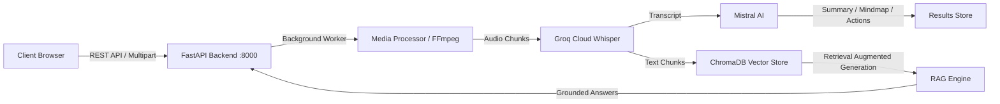

# Voxora AI 🎬

Turn audio and video recordings into structured intelligence. **Voxora AI** is a production-ready AI media assistant featuring a modern React frontend, FastAPI backend, and an interactive intelligence workspace with summaries, action items, key decisions, interactive Mermaid mind maps, and a RAG-powered chatbot.

The legacy Streamlit presentation layer (`app.py`) and CLI runner (`main.py`) remain fully functional and backwards-compatible.

---

## ✨ Features

- **Direct Media Upload**: Upload any local video or audio recording (`mp4`, `mp3`, `wav`, `m4a`, `webm`, `mkv`, `mov`, up to 200MB).
- **High-Speed Transcription**: Powered by **Groq Cloud's** `whisper-large-v3` API with automatic language detection and silence-aware segmentation.
- **Executive Intelligence**: Uses **Mistral AI** language models to extract structured insights:
  - 📝 **Executive Summary**
  - ✅ **Action Items** (with owners and deadlines)
  - 🔑 **Key Decisions**
  - ❓ **Open Questions**
- **Interactive Mind Map**: Visual hierarchical knowledge tree rendered dynamically with **Mermaid.js**, complete with zoom, pan, and SVG export.
- **Session-Isolated RAG Chat**: Context-grounded conversation assistant backed by session-scoped ChromaDB vector collections.
- **Clean Coastal Design**: Modern SaaS interface supporting both Light and Dark themes.

---

## 🏗️ Architecture & Tech Stack



- **Frontend**: React 18, Vite, JavaScript (ES6+), Tailwind CSS, Lucide React, Mermaid.js, Axios.
- **Backend**: FastAPI, Pydantic, Python 3.10+.
- **AI / LLM Orchestration**: LangChain, Mistral AI (`mistral-medium-latest`, `mistral-small-latest`), Groq Whisper (`whisper-large-v3`).
- **Embeddings & Vector Store**: HuggingFace Sentence Transformers (`sentence-transformers/all-MiniLM-L6-v2`), ChromaDB.
- **Media Processing**: FFmpeg, PyDub.

---

## 🚀 Getting Started

### Prerequisites

1. **Python 3.10+**
2. **Node.js 18+** & npm
3. **FFmpeg** installed and accessible in your system's PATH.

### 1. Backend Setup

1. **Clone the repository:**
   ```bash
   git clone https://github.com/your-username/Voxora-AI.git
   cd Voxora-AI
   ```

2. **Create and activate a virtual environment:**
   ```bash
   python -m venv .venv
   # Windows:
   .venv\Scripts\activate
   # macOS/Linux:
   source .venv/bin/activate
   ```

3. **Install Python dependencies:**
   ```bash
   pip install -r requirements.txt
   ```

4. **Configure environment variables:**
   Copy `.env.example` to `.env`:
   ```bash
   cp .env.example .env
   ```
   Edit `.env` and insert your API keys:
   ```env
   GROQ_API_KEY=gsk_...
   MISTRALAI_API_KEY=...
   ```

5. **Start the FastAPI server:**
   ```bash
   uvicorn backend.main:app --reload --port 8000
   ```
   API documentation is available at `http://localhost:8000/docs`.

---

### 2. Frontend Setup (React)

1. **Navigate to the frontend directory:**
   ```bash
   cd frontend
   ```

2. **Install dependencies:**
   ```bash
   npm install
   ```

3. **Start the development server:**
   ```bash
   npm run dev
   ```
   Open `http://localhost:5173` in your browser.

4. **Production Build:**
   ```bash
   npm run build
   ```

---

### 3. Running Legacy Streamlit or CLI

The original Streamlit interface and CLI runner remain fully compatible:

- **Streamlit App**:
  ```bash
  streamlit run app.py
  ```
- **Command Line Interface**:
  ```bash
  python main.py
  ```

---

## 🧪 Testing

Run the automated test suite covering schemas, health endpoints, job lifecycle, session isolation, and backward compatibility:

```bash
python run_tests.py
```

---

## 🔒 Security & Privacy

- All third-party AI provider credentials (`GROQ_API_KEY`, `MISTRALAI_API_KEY`) stay strictly on the server and are never exposed to the frontend.
- Vector collections are isolated per job session (`job_<job_id>`) to eliminate cross-job data leakage.
- Direct local media upload validates files by MIME type, extension, and file size (200MB maximum) with safe temporary file cleanup.
- `.env` and vector databases are strictly excluded from version control via `.gitignore`.
