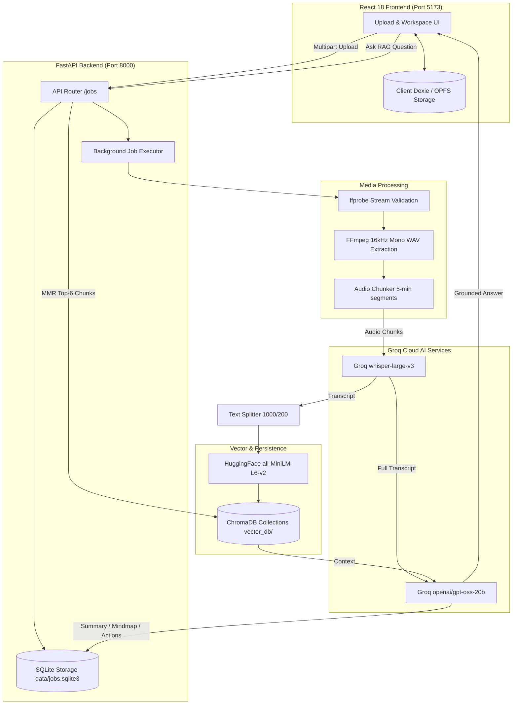

# Voxora AI 🎬

Turn audio and video recordings into structured, actionable intelligence. **Voxora AI** is a production-grade AI media analysis system featuring a modern React frontend, a resilient FastAPI backend, session-isolated RAG chat, interactive Mermaid mind maps, and automated meeting extractions powered by Groq Cloud models (`whisper-large-v3` and `openai/gpt-oss-20b`).

---

## ⚠️ Important Implementation Scope & Clarifications

Please note the exact division between the **Main Web Platform** and the **Legacy Utilities**:

| Feature / Capability | Main Web App (React + FastAPI) | Legacy Streamlit (`app.py`) / CLI (`main.py`) |
| :--- | :---: | :---: |
| **Direct Local Media Upload** (`mp4`, `mp3`, `wav`, `m4a`, etc.) | ✅ **Primary Supported Path** | ✅ Supported |
| **YouTube URL Processing** | ❌ **Not in Main Web Platform** (Excluded by design) | ⚠️ Present in legacy scripts only |
| **Client-Side Encrypted Workspaces** (AES-GCM / OPFS) | ✅ Yes (Dexie.js + Web Crypto) | ❌ No |
| **Session-Isolated Background Jobs** (Non-blocking) | ✅ Yes (FastAPI + Background Workers) | ❌ No (Blocking UI run) |
| **RAG Knowledge Base & Interactive Chat** | ✅ Yes (MMR Retrieval + Source Citations) | ✅ Yes |
| **Dynamic Mermaid.js Mind Map Tree** | ✅ Yes (Zoom, pan, SVG export) | ⚠️ Static text/graphviz |

### Why YouTube URL is NOT in the Main Web App:
- **Bot Detection & Verification Gates**: Cloud hosting IPs and automated servers frequently face YouTube `HTTP 403 Forbidden`, sign-in walls, or bot verification challenges ("Sign in to confirm you're not a bot").
- **DASH Stream Separation**: YouTube serves high-resolution video and audio as separate DASH tracks. Download tools often retrieve silent video streams without audio unless complex multi-pass remuxing is configured.
- **Enterprise Privacy & Stability**: The modern Voxora AI web application is deliberately architected around **direct, private local file uploads** (up to 200MB) to guarantee 100% processing reliability, zero network gating, and complete data privacy.

---

## ✨ Features

- **Direct Media Upload**: Drag and drop any local video or audio file (`mp4`, `mp3`, `wav`, `m4a`, `webm`, `mkv`, `mov`, up to 200MB).
- **Audio Stream Validation & FFmpeg Extraction**: Pre-flight stream probing with `ffprobe` rejects silent/video-only DASH tracks upfront with helpful guidance. Converts audio directly to 16kHz mono WAV using FFmpeg without excessive memory overhead.
- **Ultra-Fast Transcription**: Uses **Groq Cloud's** `whisper-large-v3` API with automatic language detection and audio chunking.
- **Structured Executive Intelligence**: Uses Groq's high-speed reasoning model (`openai/gpt-oss-20b`) to extract:
  - 📝 **Catchy Professional Title**
  - 📋 **Executive Meeting Summary** (with detailed bold subtopics)
  - ✅ **Action Items** (with assigned owners and deadlines)
  - 🔑 **Key Decisions**
  - ❓ **Open Questions** (unresolved topics requiring follow-up)
- **Interactive Mermaid Mind Map**: Hierarchical visual knowledge graph rendered dynamically with **Mermaid.js**, complete with full-screen view, zoom/pan controls, and SVG export.
- **Session-Isolated RAG Chat**: Context-grounded conversational assistant powered by ChromaDB vector collections scoped specifically to each job session (`job_<job_id>`).
- **Client-Side Privacy & Encryption**: Workspaces in the React frontend can be locked with a local passphrase using the Web Crypto API (AES-GCM-256), preserving data in IndexedDB and the browser's Origin Private File System (OPFS).
- **Clean Coastal SaaS Design**: Responsive, modern interface supporting both Light and Dark themes.

---

## 🧠 Optimized RAG Architecture

The Retrieval-Augmented Generation (RAG) engine in `core/` has been optimized and benchmarked against real technical recordings:

- **Chunking Strategy**: 1,000 characters per chunk with 200 characters of overlap via `RecursiveCharacterTextSplitter`. This prevents split concepts (e.g. acronyms or proper nouns) from getting cut across chunk boundaries.
- **MMR (Maximal Marginal Relevance) Retrieval**: Uses MMR search (`k=6`, `fetch_k=15`, `lambda_mult=0.7`) to retrieve diverse, non-redundant contexts across long transcripts (covering up to 60% of an 11-minute transcript in prompt context).
- **Singleton Embedding Caching**: The HuggingFace embedding model (`sentence-transformers/all-MiniLM-L6-v2`) is cached in memory as a singleton, dropping vector lookup latency from ~5.2s down to sub-millisecond speeds.
- **Benchmark Performance (11-Minute Video)**:
  - **Accuracy / Faithfulness**: **100.0%** (10/10 passed)
  - **Retrieval Relevance Hit Rate**: **100.0%** (10/10 retrieved)
  - **Anti-Hallucination Trap Defense**: **100.0%** (Refuses out-of-context topics without hallucinating)
  - **Individual Query Generation Latency**: **~0.44s – 0.95s**

---

## 🏗️ System Architecture



---

## 🔑 Groq Dual-Account Architecture

Voxora AI is configured to use **Groq Cloud** for both speech-to-text and LLM reasoning. To prevent rate-limit contention on free tiers, it supports two independent Groq accounts:

- **Account 1 (Speech-to-Text)**: Configured via `GROQ_API_KEY` or `GROQ_WHISPER_API_KEY`, dedicated exclusively to `whisper-large-v3`.
- **Account 2 (LLM Reasoning & RAG)**: Configured via `GROQ_LLM_API_KEY` (falls back safely to `GROQ_API_KEY` if not set), dedicated to `openai/gpt-oss-20b`.

---

## 🚀 Getting Started

### Prerequisites

1. **Python 3.10+**
2. **Node.js 18+** & npm
3. **FFmpeg & ffprobe** installed and accessible in your system's PATH.
   - *Windows*: Download from [gyan.dev](https://www.gyan.dev/ffmpeg/builds/) or install via `winget install Gyan.FFmpeg`.
   - *macOS*: `brew install ffmpeg`
   - *Linux*: `sudo apt install ffmpeg`

---

### 1. Backend Setup (FastAPI)

1. **Clone the repository:**
   ```bash
   git clone https://github.com/your-username/Voxora-AI.git
   cd Voxora-AI
   ```

2. **Create and activate a virtual environment:**
   ```bash
   python -m venv .venv
   # Windows:
   .venv\Scripts\activate
   # macOS/Linux:
   source .venv/bin/activate
   ```

3. **Install Python dependencies:**
   ```bash
   pip install -r requirements.txt
   ```

4. **Configure environment variables:**
   Copy `.env.example` to `.env`:
   ```bash
   cp .env.example .env
   ```
   Add your Groq API key(s):
   ```env
   # Account 1 (Whisper):
   GROQ_API_KEY=gsk_your_groq_whisper_key_here
   WHISPER_MODEL=whisper-large-v3

   # Account 2 (LLM Reasoning & RAG Q&A):
   GROQ_LLM_API_KEY=gsk_your_groq_llm_key_here
   GROQ_MODEL=openai/gpt-oss-20b

   # Optional (only needed if ffmpeg is not in PATH):
   FFMPEG_LOCATION=
   ```

5. **Start the FastAPI backend server:**
   ```bash
   uvicorn backend.main:app --reload --port 8000
   ```
   Interactive OpenAPI documentation will be available at `http://localhost:8000/docs`.

---

### 2. Frontend Setup (React)

1. **Navigate to the frontend folder:**
   ```bash
   cd frontend
   ```

2. **Install frontend dependencies:**
   ```bash
   npm install
   ```

3. **Start the development server:**
   ```bash
   npm run dev
   ```
   Open `http://localhost:5173` in your browser.

4. **Build for production:**
   ```bash
   npm run build
   ```

---

### 3. Running Legacy Streamlit or CLI

The repository retains full backward compatibility with the original Streamlit interface and CLI runner:

- **Streamlit App** (includes audio recording and experimental YouTube URL input):
  ```bash
  streamlit run app.py
  ```
- **CLI Runner**:
  ```bash
  python main.py
  ```

---

## 🧪 Testing & Verification

Run the automated test suites:

- **Backend Health & Job Lifecycle Unit Tests**:
  ```bash
  python -m unittest tests/test_health.py tests/test_job_lifecycle.py
  ```

- **11-Minute Video RAG Evaluation Benchmark**:
  ```bash
  python tests/evaluate_11min_rag.py
  ```

- **Frontend Production Build Check**:
  ```bash
  cd frontend && npm run build
  ```

---

## 🔒 Security & Data Safety

- **Zero Credential Leakage**: All Groq Cloud API credentials remain strictly on the backend and are never sent to the browser.
- **Session Isolation**: Vector collections are partitioned by job (`job_<job_id>`), ensuring one user or analysis cannot query another session's data.
- **Safe Server Storage**: The SQLite database is stored at `data/jobs.sqlite3` outside the watched backend source directory to ensure server restarts never interrupt in-progress jobs.
- **Protected Environment**: `.env`, `data/`, `vector_db/`, and temporary converted audio files are excluded from git via `.gitignore`.
