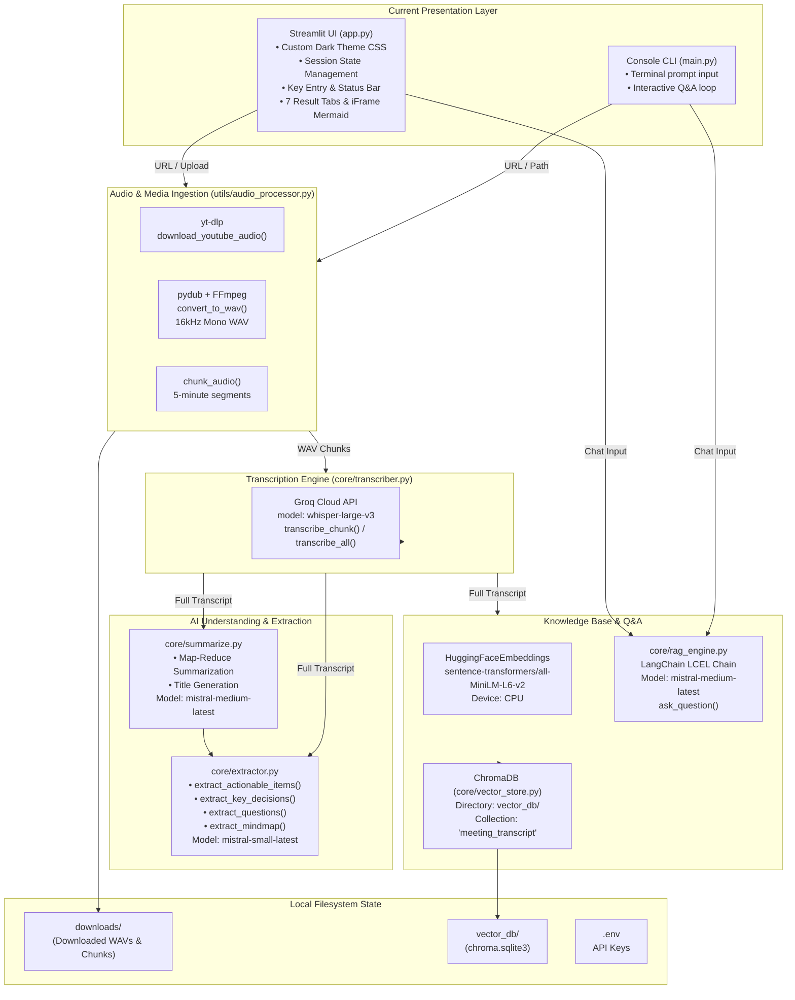
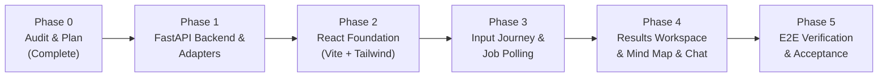

# Voxora AI — Existing Codebase Audit Report & Migration Plan

**Date:** 2026-11-09  
**Repository:** `d:\Github\GenAI Projects\AI Video Assistant`  
**Author:** Antigravity  
**Phase:** Phase 0 — Existing Codebase Audit  

---

## Executive Summary

Voxora AI is an existing Python-based AI multimedia intelligence application that transcribes video and audio content, extracts structured insights (summaries, action items, key decisions, open questions, and Mermaid.js mind maps), and builds an in-memory/persisted vector retrieval knowledge base for context-aware Q&A chat.

The current implementation couples business logic directly to a Streamlit frontend (`app.py`) and a secondary terminal CLI runner (`main.py`). The core processing pipeline in `core/` and `utils/` is functional and leverages Groq (`whisper-large-v3`), Mistral AI (`mistral-medium-latest` and `mistral-small-latest`), LangChain LCEL, HuggingFace Sentence Transformers (`all-MiniLM-L6-v2`), and ChromaDB.

This audit establishes the baseline facts, maps every feature to source code, audits function contracts and storage lifecycles, identifies critical concurrency and isolation risks, and outlines a phased, non-breaking migration strategy to a modern React (JavaScript ES6+) frontend and FastAPI backend without rewriting the AI pipeline.

---

## 1. Current Architecture Diagram



---

## 2. File and Module Responsibility Table

| File / Path | Size (Lines) | Primary Role | External Integrations / Libraries |
|---|---|---|---|
| `app.py` | 1,244 lines (43.5 KB) | **Active UI**: Streamlit application with custom dark theme, API key inputs, 9-stage pipeline tracking, 7 tabbed displays, base64 iframe Mermaid renderer, chat history, and transcript download. | `streamlit`, `os`, `tempfile`, `base64`, `utils.audio_processor`, `core.*` |
| `main.py` | 71 lines (2.3 KB) | **CLI Runner**: Terminal CLI interface prompting for API keys, running the pipeline without mind map, and running an interactive console RAG chat loop. | `os`, `utils.audio_processor`, `core.*` |
| `utils/audio_processor.py` | 96 lines (3.4 KB) | **Audio Ingestion**: YouTube download via `yt-dlp`, media conversion to 16kHz mono WAV via `pydub`/`ffmpeg`, and splitting into 5-minute WAV chunks. | `yt-dlp`, `pydub` (`AudioSegment`), `shutil`, `os` |
| `core/transcriber.py` | 37 lines (1.2 KB) | **Speech Transcription**: Groq client initialization, single chunk transcription (`whisper-large-v3`), and sequential chunk batch transcription. | `groq` (`Groq`), `os` |
| `core/summarize.py` | 59 lines (2.8 KB) | **Summarization & Title**: Map-reduce meeting summarization and 6-8 word title generation using Mistral AI. | `langchain_mistralai`, `langchain_core`, `langchain_text_splitters`, `os` |
| `core/extractor.py` | 87 lines (5.1 KB) | **Structured Extractions**: Action items (with task, owner, deadline), key decisions, open questions, and Mermaid mind map generation using Mistral AI. | `langchain_mistralai`, `langchain_core`, `langchain_text_splitters`, `os` |
| `core/vector_store.py` | 35 lines (1.5 KB) | **Vector Database**: Sentence Transformers embedding initialization, ChromaDB document ingestion (chunk 500, overlap 50), loading, and similarity retriever. | `langchain_chroma`, `langchain_community.embeddings`, `langchain_text_splitters`, `os` |
| `core/rag_engine.py` | 88 lines (2.6 KB) | **RAG Q&A**: LCEL prompt chain construction connecting Chroma retriever to `mistral-medium-latest` for strict transcript-grounded Q&A. | `langchain_mistralai`, `langchain_core`, `core.vector_store`, `os` |
| `pyproject.toml` | 36 lines (950 B) | UV project specification and dependency list. | Python >=3.12 |
| `requirements.txt` | 27 lines (364 B) | Standard pip requirements mirror. | PyPI dependencies |
| `packages.txt` | 3 lines (19 B) | System dependencies: `ffmpeg`, `nodejs`, `npm`. | Apt/OS packages |
| `.python-version` | 1 line (5 B) | Specifies Python version `3.12`. | UV / pyenv |

---

## 3. Feature-to-Code Mapping

| User Feature (Streamlit) | Entry Point | Invoked Modules & Functions | Inputs & Outputs | External APIs / Models | Files Written / Modified | Error Handling & Status |
|---|---|---|---|---|---|---|
| **YouTube Media Ingestion** | `app.py:950-957`, `app.py:890` | `utils.audio_processor.process_input()` → `download_youtube_audio()` | Input: `url: str`<br/>Output: `list[str]` (chunk paths) | `yt-dlp` download, FFmpeg post-processing | `downloads/%(title)s.wav`, `{wav}_chunk_{i}.wav` | Raises `RuntimeError` if FFmpeg missing. Verified working. |
| **Local Media Upload** | `app.py:958-971`, `app.py:890` | `st.file_uploader` → `NamedTemporaryFile` → `utils.audio_processor.process_input()` → `convert_to_wav()` | Input: `tmp.name: str`<br/>Output: `list[str]` (chunk paths) | `pydub`, `ffmpeg` conversion | `tempfile` path, `{path}_converted.wav`, `{wav}_chunk_{i}.wav` | Accepted extensions: `mp4`, `mp3`, `wav`, `m4a`, `webm`, `mkv`, `mov`. Temp files never unlinked. |
| **Audio Chunking** | `app.py:890` | `utils.audio_processor.chunk_audio()` | Input: `wav_path: str, chunk_minutes=5`<br/>Output: `list[str]` | `pydub` (16kHz mono) | Chunks written to filesystem alongside source WAV. | Verified working. |
| **Speech Transcription** | `app.py:891` | `core.transcriber.transcribe_all()` → `transcribe_chunk()` | Input: `chunks: list[str], language: str`<br/>Output: `transcript: str` | Groq Cloud (`whisper-large-v3`) | None (in-memory string) | Handles `"auto"`, `"hi"`, `"en"`. Sequential execution across chunks. |
| **Title Generation** | `app.py:892` | `core.summarize.generate_title()` | Input: `transcript[:2000]: str`<br/>Output: `title: str` (6-8 words) | Mistral AI (`mistral-medium-latest`) | None (in-memory string) | Temperature 0.3. Verified working. |
| **Meeting Summary** | `app.py:893` | `core.summarize.summarize()` | Input: `transcript: str`<br/>Output: `summary: str` (Markdown) | Mistral AI (`mistral-medium-latest`) | None (in-memory string) | Map-reduce over 3000-char chunks with 200 overlap. |
| **Action Items Extraction** | `app.py:894` | `core.extractor.extract_actionable_items()` | Input: `transcript: str`<br/>Output: `action_items: str` (Markdown numbered list) | Mistral AI (`mistral-small-latest`) | None (in-memory string) | Extracts task, owner, deadline. Temperature 0.1. |
| **Key Decisions Extraction** | `app.py:895` | `core.extractor.extract_key_decisions()` | Input: `transcript: str`<br/>Output: `key_decisions: str` (Markdown numbered list) | Mistral AI (`mistral-small-latest`) | None (in-memory string) | Deduplicates and formats decisions. |
| **Open Questions Extraction** | `app.py:896` | `core.extractor.extract_questions()` | Input: `transcript: str`<br/>Output: `questions: str` (Markdown numbered list) | Mistral AI (`mistral-small-latest`) | None (in-memory string) | Extracts unresolved questions. |
| **Mermaid Mind Map** | `app.py:897` | `core.extractor.extract_mindmap()` | Input: `summary: str` (*passed summary in app.py*)<br/>Output: `mermaid_code: str` | Mistral AI (`mistral-small-latest`) | None (rendered via iframe in `app.py`) | Strips backticks; `app.py` parses node lines into `n{i}["`text`"]` and renders with Mermaid 10 in sandboxed HTML iframe. |
| **Vector DB Indexing** | `app.py:898` | `core.vector_store.build_vector_store()` | Input: `transcript: str`<br/>Output: `Chroma` instance | HuggingFace `all-MiniLM-L6-v2` | Persists to `vector_db/chroma.sqlite3` | Hardcoded collection name `"meeting_transcript"` causes document accumulation across runs. |
| **RAG Knowledge Q&A** | `app.py:1215-1222` | `core.rag_engine.ask_question()` | Input: `rag_chain, question: str`<br/>Output: `answer: str` | Mistral AI (`mistral-medium-latest`) | None (in-memory chat history) | Answers strictly from transcript context; fallback text if not found. |
| **Transcript Download** | `app.py:1241-1244` | `st.download_button` | Input: `transcript: str`<br/>Output: `transcript.txt` file download | Browser local download | None | Plain text export. |

---

## 4. Existing Entry-Point Explanation

1. **`app.py` (Current Primary Presentation Layer)**:
   - Run command: `streamlit run app.py`
   - Purpose: Main full-featured web interface.
   - Handles:
     - Setting page layout (`wide`) and injecting custom styling CSS.
     - Reading and storing `GROQ_API_KEY` and `MISTRALAI_API_KEY` into `os.environ`.
     - Selecting source type (YouTube vs Local file) and language.
     - Writing uploaded file to `tempfile.NamedTemporaryFile`.
     - Triggering `run_pipeline_ui()` with live step-by-step UI updates across 9 steps.
     - Storing output dictionary in `st.session_state["pipeline_result"]`.
     - Rendering results across 7 tabs, with an iframe-rendered Mermaid mind map.
     - Interactive chat using Streamlit chat messages and `st.session_state["chat_history"]`.
   - **Does NOT contain any FastAPI or REST API code.**

2. **`main.py` (CLI Fallback / Diagnostic Entry Point)**:
   - Run command: `python main.py`
   - Purpose: Quick terminal-based execution.
   - Handles:
     - Terminal prompts for keys if missing in `os.environ`.
     - Runs `run_pipeline(source: str)`: processes input, transcribes, generates title, summarizes, extracts action items, decisions, and questions, builds RAG chain.
     - Prints results to `stdout`.
     - Launches interactive `while True` loop for Q&A in the terminal.
     - **Notice:** `main.py` does *not* invoke `extract_mindmap()`.
   - **Does NOT contain any FastAPI or REST API code.**

3. **Current API / Backend Status**:
   - There is **no existing FastAPI, Flask, or REST API layer**.
   - Streamlit currently acts as both frontend and backend in a single monolithic process.

---

## 5. Function Contract Inventory

### `utils/audio_processor.py`

#### `download_youtube_audio(url: str) -> str`
- **Signature:** `def download_youtube_audio(url: str) -> str`
- **Behavior:** Synchronous.
- **Return:** Absolute or relative path to downloaded WAV file (`downloads/<title>.wav`).
- **Exceptions:** `RuntimeError` if FFmpeg/FFprobe missing; `yt_dlp.utils.DownloadError` on invalid URL or network failure.
- **Environment:** `FFMPEG_LOCATION` (optional).
- **Filesystem:** Writes to `downloads/`.
- **Concurrency:** Uses `%(title)s.%(ext)s`. Concurrent downloads of the same video will collide.

#### `convert_to_wav(input_path: str) -> str`
- **Signature:** `def convert_to_wav(input_path: str) -> str`
- **Behavior:** Synchronous.
- **Return:** Path to converted file (`<input_path_without_ext>_converted.wav`).
- **Exceptions:** `RuntimeError` if FFmpeg missing; `pydub.exceptions.CouldntDecodeError` on invalid format.
- **Environment:** `FFMPEG_LOCATION` (optional).
- **Filesystem:** Reads `input_path`, writes sibling `_converted.wav`.

#### `chunk_audio(wav_path: str, chunk_minutes: int = 5) -> list[str]`
- **Signature:** `def chunk_audio(wav_path: str, chunk_minutes: int = 5) -> list[str]`
- **Behavior:** Synchronous.
- **Return:** List of string paths: `[f"{wav_path}_chunk_{i}.wav", ...]`.
- **Exceptions:** `pydub.exceptions.CouldntDecodeError`.
- **Filesystem:** Writes multiple chunk WAV files adjacent to `wav_path`.

#### `process_input(source: str) -> list[str]`
- **Signature:** `def process_input(source: str) -> list[str]`
- **Behavior:** Synchronous router (`http` → download, otherwise convert) followed by `chunk_audio`.
- **Return:** List of chunk file paths.

---

### `core/transcriber.py`

#### `get_client() -> Groq`
- **Signature:** `def get_client() -> Groq`
- **Environment:** Requires `os.environ.get("GROQ_API_KEY")`.

#### `transcribe_chunk(chunk_path: str, translate: bool = False, language: str = None) -> str`
- **Signature:** `def transcribe_chunk(chunk_path: str, translate: bool = False, language: str = None) -> str`
- **Behavior:** Synchronous Groq Cloud API call.
- **Model:** `whisper-large-v3`.
- **Return:** Transcribed text string.
- **Exceptions:** `groq.APIConnectionError`, `groq.AuthenticationError`, `FileNotFoundError`.

#### `transcribe_all(chunks: list, translate: bool = False, language: str = None) -> str`
- **Signature:** `def transcribe_all(chunks: list, translate: bool = False, language: str = None) -> str`
- **Behavior:** Synchronous loop over `chunks`. Concatenates chunk transcripts with space.
- **Return:** Stripped full transcript string.

---

### `core/summarize.py`

#### `get_llm() -> ChatMistralAI`
- **Signature:** `def get_llm() -> ChatMistralAI`
- **Model:** `mistral-medium-latest`, `temperature=0.3`.
- **Environment:** Requires `os.getenv("MISTRALAI_API_KEY")`.

#### `split_transcript(transcript: str) -> list[str]`
- **Signature:** `def split_transcript(transcript: str) -> list[str]`
- **Chunking:** `RecursiveCharacterTextSplitter(chunk_size=3000, chunk_overlap=200)`.

#### `summarize(transcript: str) -> str`
- **Signature:** `def summarize(transcript: str) -> str`
- **Behavior:** Synchronous Map-Reduce.
  - Map: Prompts `mistral-medium-latest` for each 3000-char chunk.
  - Reduce: Combines partial summaries into structured markdown.
- **Return:** Formatted Markdown summary.

#### `generate_title(transcript: str) -> str`
- **Signature:** `def generate_title(transcript: str) -> str`
- **Behavior:** Synchronous LCEL chain over `transcript[:2000]`.
- **Return:** Clean title string (6-8 words max, no quotes).

---

### `core/extractor.py`

#### `get_llm() -> ChatMistralAI`
- **Signature:** `def get_llm() -> ChatMistralAI`
- **Model:** `mistral-small-latest`, `temperature=0.1`.
- **Environment:** Requires `os.getenv("MISTRALAI_API_KEY")`.

#### `build_chunked_extractor(item_prompt: str, merge_prompt: str) -> callable`
- **Signature:** Returns `extract(transcript: str) -> str`.
- **Behavior:** Splits transcript into 3000-char chunks, executes `item_chain` on each chunk, then executes `merge_chain` if more than 1 chunk.

#### `extract_actionable_items(transcript: str) -> str`
- **Output format:** Markdown numbered list with Task description, Owner, Deadline.

#### `extract_key_decisions(transcript: str) -> str`
- **Output format:** Markdown numbered list of decisive outcomes.

#### `extract_questions(transcript: str) -> str`
- **Output format:** Markdown numbered list of open follow-up questions.

#### `extract_mindmap(transcript: str) -> str`
- **Output format:** ````mermaid\nmindmap\n...\n```` string.
- **Note:** In `app.py`, this function is called with `summary` rather than `transcript` to prevent token limits and produce higher-level maps.

---

### `core/vector_store.py`

#### `get_embeddings() -> HuggingFaceEmbeddings`
- **Model:** `sentence-transformers/all-MiniLM-L6-v2` (`device="cpu"`).

#### `build_vector_store(transcript: str) -> Chroma`
- **Signature:** `def build_vector_store(transcript: str) -> Chroma`
- **Chunking:** `RecursiveCharacterTextSplitter(chunk_size=500, chunk_overlap=50)`.
- **Metadata:** `{"source": f"chunk_{i}"}`.
- **Persistence:** Persists to `vector_db/` under hardcoded `COLLECTION_NAME = "meeting_transcript"`.
- **Critical Caveat:** Does not isolate by session or job; documents accumulate across runs.

#### `load_vector_store() -> Chroma`
- **Signature:** `def load_vector_store() -> Chroma`
- **Behavior:** Loads the hardcoded collection `"meeting_transcript"` from `vector_db/`.

#### `get_retriever(vector_store: Chroma, k: int = 4) -> VectorStoreRetriever`
- **Similarity search:** top `k=4` chunks.

---

### `core/rag_engine.py`

#### `build_rag_chain(transcript: str) -> Runnable`
- **Behavior:** Builds vector store, creates retriever, builds LCEL chain:
  `{"context": retriever | format_docs, "question": RunnablePassthrough()} | prompt | llm | StrOutputParser()`.
- **Prompt:** Strict meeting assistant; replies `"I could not find this information in the meeting transcript."` when context is absent.

#### `ask_question(rag_chain, question: str) -> str`
- **Signature:** `def ask_question(rag_chain, question: str) -> str`
- **Behavior:** Invokes `rag_chain.invoke(question)`.

---

## 6. Data and Storage Lifecycle

1. **Media Ingestion**:
   - `download_youtube_audio()` saves files into `downloads/%(title)s.wav`.
   - `convert_to_wav()` saves files adjacent to the source: `<source_path>_converted.wav`.
   - Neither function cleans up original downloaded files or converted intermediate WAVs.
2. **Chunk Files**:
   - `chunk_audio()` generates `<wav_path>_chunk_0.wav`, `_chunk_1.wav`, etc.
   - Chunks are never deleted after transcription completes.
3. **Uploaded Files**:
   - In `app.py`, uploaded files are written to `tempfile.NamedTemporaryFile(delete=False)`.
   - The file handle is never explicitly closed or unlinked on job completion or error.
4. **Analysis Outputs**:
   - Transcripts, titles, summaries, action items, decisions, questions, and mind maps exist strictly in memory (`st.session_state` in Streamlit, or local variables in `main.py`).
   - No persistent file or database stores job results.
5. **Vector Store & Indexing**:
   - Stored in `vector_db/chroma.sqlite3`.
   - Hardcoded collection name `"meeting_transcript"`.
   - Existing vector data in `vector_db/` is currently preserved, but each new execution adds more documents into the same collection, causing cross-contamination.

---

## 7. Dependency and Environment Inventory

### System & Runtimes
- **OS:** Windows 11 (tested on PowerShell).
- **Python:** `3.12.4` (managed via `uv` and `.python-version`).
- **Node.js:** `v26.3.0`.
- **npm:** `11.3.0`.
- **FFmpeg / FFprobe:** Installed and verified in system PATH (`ffmpeg version N-124714-g49a77d37be-20260531`).

### Python Dependencies (Audited from `pyproject.toml` & `requirements.txt`)
- AI & Orchestration: `langchain>=1.3.1`, `langchain-core>=1.4.0`, `langchain-community>=0.4.1`, `langchain-groq>=1.1.2`, `langchain-mistralai>=1.1.4`, `langchain-huggingface>=1.2.2`, `groq>=0.11.0`
- Vector Store & Embeddings: `chromadb>=1.5.9`, `sentence-transformers>=5.5.0`, `torch>=2.12.0`
- Media Processing: `yt-dlp>=2026.1.1`, `pydub>=0.25.1`, `ffmpeg-python>=0.2.0`
- Current UI: `streamlit>=1.57.0`, `streamlit-extras>=1.6.0`
- Utilities: `python-dotenv>=1.2.2`, `requests>=2.34.2`, `tqdm>=4.67.3`, `numpy>=2.4.5`

### Dependencies Needed for Target Backend
- `fastapi`
- `uvicorn`
- `python-multipart`

### Environment Variables
- `GROQ_API_KEY`: Required for Groq Whisper transcription.
- `MISTRALAI_API_KEY`: Required for Mistral summarization, extraction, and RAG.
- `WHISPER_MODEL`: Listed in `.env` (currently hardcoded as `"whisper-large-v3"` in `core/transcriber.py`).
- `OLLAMA_API_KEY`: Listed in `.env` (unused in existing source).
- `FFMPEG_LOCATION`: Optional directory or path override for FFmpeg.
- `TRANSFORMERS_VERBOSITY`: Set to `"error"` in `app.py` to silence HuggingFace notices.

---

## 8. Verified Issues, Risks, and Mitigations

| Issue / Risk | Evidence in Code | Impact | Proposed Mitigation in Migration |
|---|---|---|---|
| **1. Vector DB Cross-Contamination** | `core/vector_store.py:8` uses hardcoded `COLLECTION_NAME = "meeting_transcript"`. | RAG chat for Video B will retrieve chunks from Video A. | Parameterize collection naming in `build_vector_store(transcript, collection_name)` or use job-scoped collections (e.g. `f"job_{job_id}"`), while retaining default parameters for backward compatibility. |
| **2. Uncontrolled Disk Accumulation** | `audio_processor.py` never deletes `.wav` or `_chunk_*.wav` files; `app.py` leaves temp files. | Disk fills up with large audio files over time. | Backend job runner isolates audio processing in a per-job temporary workspace and cleans up intermediate chunk files after transcription succeeds. Existing files in `downloads/` and `vector_db/` remain untouched. |
| **3. Blocking Synchronous HTTP Requests** | The full pipeline (download + chunk + Whisper + 4 Mistral chains + Chroma indexing) takes 30s to 5+ minutes. | HTTP request timeout if executed directly in a route handler. | Implement an asynchronous background job manager with unique `job_id`, polling via `/api/jobs/{job_id}`, and stage tracking. |
| **4. Process-Level Secret Mutation** | `app.py:812, 833` sets `os.environ["GROQ_API_KEY"] = ...` at runtime. | In a multi-request FastAPI server, modifying `os.environ` is not thread-safe. | Backend loads keys from `.env` or system environment at startup. If client-provided keys are required, pass them explicitly into adapters. |
| **5. SSRF / Arbitrary URL Ingestion** | `audio_processor.py:85` checks only `source.startswith("http://")`. | Arbitrary internal network probing or SSRF via `yt-dlp`. | Implement strict host validation on `POST /api/jobs/youtube` (restricting to `youtube.com`, `youtu.be`). |
| **6. Mind Map Input Discrepancy** | `extractor.py:78` defines `extract_mindmap(transcript)`, but `app.py:897` calls `extract_mindmap(summary)`. | Passing raw transcripts to `extract_mindmap` can exhaust Mistral context or create overly noisy mind maps. | The adapter will follow the verified `app.py` behavior: pass the generated `summary` into `extract_mindmap()`. |
| **7. Mermaid Parsing & Escaping** | `app.py:1123-1138` rewrites Mermaid lines into `n{i}["`text`"]` to prevent syntax parsing failures. | Raw Mermaid code generated by LLM often contains unescaped characters, breaking client rendering. | Port the sanitization / quote-wrapping logic to backend/frontend and render with `mermaid.js` inside a resilient React component with error fallback. |

---

## 9. Minimal Proposed Target Architecture

### Layering Strategy

```text
ai-video-assistant/
├── backend/
│   ├── main.py                  # FastAPI app entry point (CORS, router inclusion)
│   ├── api/
│   │   ├── routes/
│   │   │   ├── health.py        # GET /api/health
│   │   │   ├── jobs.py          # POST /upload, POST /youtube, GET /{job_id}
│   │   │   ├── results.py       # GET /{job_id}/results, /transcript, /mindmap, /download
│   │   │   └── chat.py          # POST /{job_id}/chat
│   ├── schemas/
│   │   ├── jobs.py              # Pydantic schemas: JobCreate, JobStatus, JobStage enum
│   │   ├── results.py           # AnalysisResult, SummaryResult, ActionItem, MindmapResult
│   │   ├── chat.py              # ChatRequest, ChatResponse
│   │   └── errors.py            # Consistent ErrorEnvelope
│   ├── services/
│   │   ├── job_service.py       # In-memory background job orchestrator (threading/asyncio)
│   │   └── adapters.py          # Thin adapters to existing core/ and utils/
├── frontend/                    # Vite + React (JavaScript ES6+ / JSX only)
│   ├── src/
│   │   ├── components/
│   │   │   ├── common/          # Header, Badge, Button, Tabs, ErrorAlert
│   │   │   ├── upload/          # YouTubeInput, FileDropzone, LanguageSelector
│   │   │   ├── processing/      # StageTracker, HonestProgress, ErrorDisplay
│   │   │   ├── workspace/       # ResultsHeader, StatsRow, TabNavigation
│   │   │   ├── summary/         # ExecutiveSummaryView, ActionItemsView, DecisionsView, QuestionsView
│   │   │   ├── mindmap/         # MermaidRenderer (Mermaid.js with zoom/pan & fallback)
│   │   │   ├── chat/            # GroundedChatPanel, MessageBubble, ChatInput
│   │   │   └── transcript/      # TranscriptViewer, DownloadButton
│   │   ├── pages/
│   │   │   ├── HomePage.jsx     # Ingestion & hero landing
│   │   │   └── WorkspacePage.jsx# Job processing & full results workspace
│   │   ├── services/
│   │   │   └── api.js           # Centralized Axios / fetch client with error normalization
│   │   ├── hooks/
│   │   │   └── useJobPolling.js # Robust polling hook with unmount cleanup
│   │   ├── App.jsx
│   │   ├── main.jsx
│   │   └── index.css            # Tailwind CSS matching Voxora dark palette
│   ├── package.json
│   ├── vite.config.js
│   └── tailwind.config.js
├── core/                        # PRESERVED: existing extractor, rag_engine, summarize, etc.
├── utils/                       # PRESERVED: existing audio_processor.py
├── downloads/                   # PRESERVED: existing audio files intact
├── vector_db/                   # PRESERVED: existing chroma database intact
├── app.py                       # PRESERVED: Streamlit application remains functional fallback
└── main.py                      # PRESERVED: CLI tool remains functional
```

---

## 10. Migration Sequence and Rollback Strategy

### Phased Sequence



1. **Phase 0 — Existing Codebase Audit & Plan** *(Current)*:
   - Deliver `docs/CODEBASE_AUDIT_REPORT.md`.
   - Gate: User reviews and approves audit findings.
2. **Phase 1 — Backend Extraction / FastAPI Adapter**:
   - Add `fastapi`, `uvicorn`, `python-multipart` to UV dependencies.
   - Implement `backend/services/adapters.py` wrapping existing `core/` and `utils/` with job collection isolation.
   - Implement `backend/services/job_service.py` to run long-running stages in background worker threads without blocking HTTP.
   - Implement Pydantic models in `backend/schemas/` based on inspected outputs.
   - Implement routes for health, jobs (upload/youtube), status, results, chat, and download.
   - Add unit/integration tests for adapters and endpoints.
   - Gate: Backend starts cleanly; existing pipeline can be invoked via API with identical outputs.
3. **Phase 2 — React Foundation (JavaScript ES6+ Only)**:
   - Initialize Vite React JavaScript project in `frontend/`.
   - Configure Tailwind CSS using Voxora's dark editorial palette (`#06060f`, `#7c4ddc`, `#1ec8a8`).
   - Create centralized API client in `frontend/src/services/api.js`.
   - Setup React Router with `/` and `/workspace/:jobId`.
   - Gate: Frontend builds cleanly (`npm run build`) and connects to `/api/health`.
4. **Phase 3 — Main Ingestion Journey**:
   - Build Home page with YouTube URL input and drag-and-drop file uploader.
   - Implement language selector ("Auto-Detect", "Hindi", "English").
   - Wire submission to `POST /api/jobs/youtube` and `POST /api/jobs/upload`.
   - Implement honest stage-by-stage status tracker showing real backend status (`DOWNLOADING`, `PREPARING_AUDIO`, `TRANSCRIBING`, `ANALYZING`, `INDEXING`, `COMPLETED`).
   - Gate: User can submit YouTube URL or local file and observe real progress through completion.
5. **Phase 4 — Results Workspace**:
   - Build multi-tab / split workspace matching `app.py` features:
     - Overview & Summary
     - Action Items with owner and deadline badges
     - Key Decisions list
     - Open Questions list
     - Interactive Mermaid Mind Map (rendered via `mermaid.js` with syntax sanitizer and pan/zoom)
     - Source-grounded RAG Chat with conversational history
     - Raw Transcript view with one-click `.txt` download
   - Gate: All 7 feature areas from Streamlit are accessible and visually superior in React.
6. **Phase 5 — Polish, Verification & Acceptance**:
   - Test responsive layout across mobile, tablet, and desktop breakpoints.
   - Verify keyboard navigation, accessibility attributes, and focus states.
   - Test end-to-end processing with real media and YouTube URLs.
   - Verify that `downloads/`, `vector_db/`, and `.env` remain preserved.
   - Provide final runbook with exact startup commands.

### Rollback Strategy
- **Zero Destructive Changes:** Neither `app.py`, `main.py`, nor the original `core/` and `utils/` modules are deleted or refactored away.
- **Immediate Fallback:** If any issue occurs during React or FastAPI development, running `streamlit run app.py` remains 100% operational at any time.
- **Data Safety:** No migration script touches `vector_db/` or `downloads/`.

---

## 11. Questions Requiring User Decision

Before finalizing Phase 1 implementation details:

1. **API Key Management in Production**:
   - In `app.py`, keys could be entered in the sidebar per session.
   - In the target architecture, should API keys be configured primarily via server `.env` (recommended for standard web apps), or should the UI still permit optional per-session key overrides in request headers?
2. **Vector Store Retention Policy**:
   - Existing vector data in `vector_db/chroma.sqlite3` is preserved.
   - For new jobs, should each job use an ephemeral collection that is kept in-memory for the duration of the server run, or should each job persist to a distinct collection in `vector_db/` named `job_<job_id>`? *(Persisting by job ID is recommended so users can reload earlier sessions).*
3. **Upload File Size Limit**:
   - The Streamlit default is 200MB. What maximum upload limit would you like enforced on the FastAPI backend (e.g. 100MB, 200MB, or 500MB)?
4. **Mind Map Scope**:
   - In `app.py`, the mind map is generated by passing the `summary` rather than the raw transcript. We recommend keeping this behavior to preserve performance and avoid token limits. Please confirm if this is acceptable.

---

*Phase 0 audit complete. Awaiting user review before Phase 1 implementation.*

